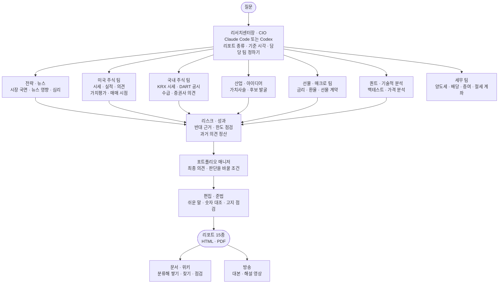
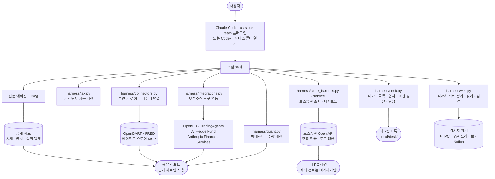

# 주식 리서치 하네스 · AI 리서치센터와 헤지펀드 팀

AI에게 주식을 물어보면, 증권사 리서치센터와 헤지펀드처럼 여러 팀이 나눠 조사하고 서로 검증한 뒤 **주식을 몰라도 읽을 수 있는 한국어 리포트**로 정리해 주는 도구입니다. Claude Code와 Codex에서 씁니다.

- "삼성전자 지금 사도 될까?", "엔비디아 분석해 줘"처럼 평소 말투로 물어보면 됩니다.
- 전략, 뉴스, 미국 주식, 국내 주식, 산업, ETF, 선물·매크로, 퀀트, 리스크, 세무, 편집·준법, 문서·위키, 방송까지 AI 34명이 일합니다.
- 주식 양도세, 배당, 증여세, 절세 계좌 같은 한국 투자 세금을 법령 근거와 함께 계산해 줍니다.
- GitHub 오픈소스 28개를 공개 기준 다섯 항목으로 채점해, 6개는 명령으로 직접 부르고 4개는 계산법 일부를 직접 구현했습니다.
- 만든 리포트는 내 PC, 구글 드라이브, Notion 중 원하는 곳의 리서치 위키에 쌓아 두고 다시 찾아볼 수 있습니다.
- 모닝 브리프, 마감 시황, 뉴스 브리핑, 기업·산업 리포트, 실적 프리뷰 등 리포트 15종을 받을 수 있습니다.
- 결과는 쉬운 말로 쓴 리포트(HTML·PDF)로 받고, 모든 숫자에 출처가 붙습니다.
- DART, 한국은행, FRED 같은 데이터와 토스증권 계좌는 원하는 사람만 본인 키로 연결합니다.

소개 페이지와 실제 리포트 예시: https://axlabs-stock-harness.onpod.ai

> 에이전트 팀의 의견은 조사 자료이며 투자 조언이나 권유가 아닙니다. 투자 판단과 책임은 본인에게 있습니다. 하네스는 주문을 대신 넣지 않으며, 투자는 본인이 증권사에서 직접 합니다. 선물은 원금보다 큰 손실이 날 수 있습니다.

---

## 처음이라면 이 순서대로

### 1. 준비물 확인

아래 둘 중 **하나만** 있으면 됩니다.

| 프로그램 | 설치 안내 |
| --- | --- |
| Claude Code | https://code.claude.com/docs |
| Codex | https://developers.openai.com/codex |

공개 자료 조사만 할 때는 따로 API 키가 필요 없습니다. 쓰고 있는 Claude 또는 Codex 계정을 그대로 사용합니다.

### 2. 내려받기

**방법 A · ZIP으로 받기 (가장 쉬움)**

1. [Releases 페이지](https://github.com/seulee26/stock-team-harness/releases/latest)에서 ZIP 파일을 받습니다.
2. 압축을 풉니다. 풀린 폴더를 앞으로 "하네스 폴더"라고 부르겠습니다.

**방법 B · git으로 받기**

```sh
git clone https://github.com/seulee26/stock-team-harness.git
```

### 3. 실행하기

터미널을 열고 하네스 폴더로 이동한 뒤, 쓰는 프로그램에 맞는 명령을 실행합니다.

**Claude Code**

```sh
claude --plugin-dir ./claude/us-stock-team
```

**Codex**

```sh
codex
```

Codex 앱을 쓴다면 하네스 폴더를 프로젝트 폴더로 열면 됩니다.

### 4. 첫 질문 해 보기

무엇부터 해야 할지 모르겠다면 이렇게 물어보세요. 시작 가이드가 지금 상태를 확인하고 한 단계씩 안내합니다.

```text
처음인데 뭐부터 하면 돼?
```

바로 분석을 받고 싶다면 종목 이름만 바꿔서 물어보세요.

```text
엔비디아(NVDA) 지금 사도 될까? 초보자도 이해할 수 있게 분석해 줘.
```

```text
삼성전자(005930) 최근 실적과 수급을 쉽게 정리해 줘.
```

몇 분 뒤 리포트 파일이 만들어집니다. 리포트에는 한 줄 결론과 이유, 지금 가격이 비싼지 싼지, 사도 되는 조건과 기다려야 하는 조건, 조심할 점, 근거 자료의 출처가 담깁니다.

---

## 한눈에 보는 구조

### 회사처럼 나눈 조직

질문이 들어오면 현재 대화가 리서치센터장 겸 최고투자책임자(CIO) 역할을 맡아 필요한 팀에만 일을 나눠 줍니다.



| 조직 | 에이전트 | 맡은 일 |
| --- | --- | --- |
| 전략·뉴스 | `strategist`, `news`, `sentiment` | 시장 국면과 자산별 시각, 뉴스의 사실과 영향, 심리와 포지셔닝 |
| 미국 주식 팀 | `market`, `fundamentals`, `analyst-opinions`, `valuation`, `trade-timing` | 미국 상장 주식·ETF의 시세, 실적, 증권사 의견, 적정 가격, 매매 조건 |
| 국내 주식 팀 | `kr-market`, `kr-fundamentals`, `kr-flows` | 코스피·코스닥 시세, DART 공시와 지배구조, 수급과 증권사 의견 |
| 산업·아이디어·ETF | `sector`, `idea-screener`, `etf-analyst` | 산업 구조와 가치사슬, 조건에 맞는 후보 발굴, ETF 구조와 비교 |
| 선물·매크로 팀 | `macro`, `futures` | 금리·환율·물가와 중앙은행 일정, 선물 계약 명세·증거금·레버리지 |
| 퀀트·기술적 분석 | `quant-research`, `technical` | 전략 백테스트와 과최적화 점검, 추세와 지지·저항 |
| 리스크·성과 | `risk-review`, `risk-officer`, `performance` | 결론이 틀릴 수 있는 이유, 포트폴리오 한도, 과거 의견의 지수 대비 정산 |
| 운용 | `portfolio-manager` | 팀 의견을 종합한 최종 의견 |
| 세무 | `tax-securities`, `tax-gift`, `tax-accounts`, `tax-reviewer` | 주식 양도·배당 세금, 증여·상속, 절세 계좌, 법령 대조 검증 |
| 오픈소스 심사 | `oss-evaluator` | 새 도구를 넣기 전에 같은 기준으로 채점 |
| 편집·준법 | `editor`, `compliance` | 초보자가 읽을 수 있게 다듬기, 표현·고지·개인정보 점검 |
| 문서·위키 | `wiki-librarian`, `wiki-auditor` | 리포트를 위키에 분류해 넣기, 오래되거나 어긋난 문서 점검 |
| 방송 | `broadcast-writer`, `broadcast-director` | 완성된 리포트를 해설 영상 대본으로 옮기기, 리포트와 대조해 영상 만들기 |
| 운영 | `stock-sale-fee` | 팔 때 드는 수수료와 세금 |

### 하네스 구성

스킬과 에이전트는 AI가 읽는 지침이고, `harness/`와 `service/`는 내 PC에서 실행되는 프로그램입니다.



- 화살표는 일을 시키거나 자료가 흘러가는 방향입니다.
- 공유 리포트에는 공개 자료만 들어갑니다. 토스증권 계좌 정보는 내 PC 화면에서만 보입니다.
- 데이터 연결, 토스증권, 오픈소스 도구는 모두 선택 사항입니다. 연결하지 않아도 리서치 팀은 동작합니다.

---

## Claude Code 플러그인으로 쓰기

이 저장소의 `claude/us-stock-team` 폴더가 Claude Code 플러그인입니다. 불러오면 스킬 38개와 전문 에이전트 34명이 추가됩니다.

### 불러오는 방법 두 가지

**방법 1 · 폴더에서 바로 불러오기 (권장)**

하네스 폴더에서 아래 명령으로 시작합니다. 백테스트, 데이터 연결, 토스증권까지 모두 쓸 수 있습니다.

```sh
claude --plugin-dir ./claude/us-stock-team
```

**방법 2 · GitHub에서 설치하기**

Claude Code 안에서 아래 두 줄을 차례로 입력합니다. 한 번 설치하면 어느 폴더에서든 리서치 팀을 부를 수 있습니다.

```text
/plugin marketplace add seulee26/stock-team-harness
```

```text
/plugin install us-stock-team@stock-team-harness
```

방법 2로는 스킬과 에이전트만 설치됩니다. 백테스트, 데이터 연결, 토스증권 조회, 대시보드는 하네스 폴더 안의 프로그램을 쓰기 때문에 방법 1로 실행해야 합니다.

### 스킬 부르는 법

평소 말투로 요청해도 알맞은 스킬이 골라집니다. 직접 고르려면 `/us-stock-team:스킬이름` 뒤에 요청을 적습니다. Codex에서는 `$스킬이름`으로 부릅니다.

```text
/us-stock-team:morning-note 오늘 한국장 열리기 전에 볼 것 정리해 줘.
```

---

## 받을 수 있는 리포트 15종

증권사 리서치센터가 내는 리포트 종류를 기준으로 나눴습니다. 무엇을 골라야 할지 모르겠으면 "어떤 리포트를 받을 수 있어?"라고 물어보세요.

### 매일·매주 보는 것

| 리포트 | 이럴 때 | 스킬 | 요청 예시 |
| --- | --- | --- | --- |
| 모닝 브리프 | 장 열리기 전에 볼 것 | `morning-note` | "오늘 장 전에 뭐 봐야 해?" |
| 마감 시황 | 오늘 시장이 움직인 이유 | `market-wrap` | "오늘 코스피 왜 빠졌어?" |
| 뉴스 브리핑 | 뉴스가 주가에 주는 영향 | `news-brief` | "이 뉴스가 반도체주에 무슨 의미야?" |
| 주간 전략 | 이번 주 시장과 자산별 시각 | `weekly-strategy` | "이번 주 시장 어떻게 봐?" |
| 일정 캘린더 | 앞으로 중요한 일정 | `catalyst-calendar` | "이번 달 중요한 일정 정리해 줘." |

### 종목과 산업

| 리포트 | 이럴 때 | 스킬 | 요청 예시 |
| --- | --- | --- | --- |
| 기업 분석 (미국) | 미국 종목을 처음부터 끝까지 | `us-stock-research` | "애플 지금 사도 될까?" |
| 기업 분석 (국내) | 국내 종목을 처음부터 끝까지 | `kr-stock-research` | "삼성전자 실적과 수급 알려 줘." |
| 실적 프리뷰 | 실적 발표 전에 볼 것 | `earnings-preview` | "엔비디아 실적 발표 전에 뭘 봐야 해?" |
| 실적 리뷰 | 발표된 실적 평가 | `stock-earnings-review` | "테슬라 이번 분기 실적 어땠어?" |
| 산업 리포트 | 산업 구조와 유리한 기업 | `sector-report` | "2차전지 산업 구조 정리해 줘." |
| 아이디어 발굴 | 조건에 맞는 후보 찾기 | `idea-screen` | "배당 꾸준한 종목 후보 찾아 줘." |

### 판단과 관리

| 리포트 | 이럴 때 | 스킬 | 요청 예시 |
| --- | --- | --- | --- |
| 투자위원회 메모 | 여러 팀이 함께 심사 | `hedge-fund-desk` | "투자위원회 열어서 검토해 줘." |
| 투자 논지 점검 | 내 생각이 아직 유효한지 | `thesis-tracker` | "이 종목 계속 들고 가도 돼?" |
| 포트폴리오 점검 | 보유 종목 전체의 쏠림과 위험 | `portfolio-review` | "내 포트폴리오 점검해 줘." |
| 선물·매크로 노트 | 선물, 금리, 환율 | `futures-macro-research` | "코스피200 선물 한 계약이 얼마짜리야?" |
| 퀀트 노트 | 전략이 과거에 통했는지 | `quant-backtest` | "골든크로스 전략 백테스트해 줘." |

리포트는 바로 만들지 않고 먼저 물어봅니다: 어떤 리포트를, 얼마나 깊게(한 장 요약·표준·심층), 어떤 형식으로(채팅 답변·HTML·PDF) 받을지. 이미 말한 것은 다시 묻지 않고, "알아서 해 줘"라고 하면 기본값으로 진행합니다.

모든 리포트는 내보내기 전에 편집 역할이 쉬운 말과 숫자를 점검하고, 준법 역할이 표현과 고지를 점검합니다.

### 그 밖의 스킬

| 스킬 | 이럴 때 씁니다 |
| --- | --- |
| `stock-harness-start` | 처음 설치했거나 사용법이 궁금할 때 |
| `research-desk` | 어떤 리포트가 필요한지 고를 때 |
| `kr-tax-desk` | 투자 세금이 궁금할 때 (아래 세무 안내 참고) |
| `etf-research` | ETF의 구조와 세금 차이를 비교할 때 |
| `oss-scout` | 새 오픈소스를 넣을지 평가할 때 |
| `research-wiki` | 리포트를 내 PC, 구글 드라이브, Notion의 위키에 쌓고 찾을 때 |
| `report-email` | 리포트를 Gmail로 받거나 보낼 때 |
| `report-broadcast` | 완성된 리포트를 주식 방송 형식의 해설 영상으로 만들 때 |
| `broadcast-interview` | 해설 영상을 앵커와 전문가가 묻고 답하는 대담 형식으로 만들 때 |
| `broadcast-music` | 해설 영상에 넣을 배경 음악을 찾아 라이선스와 함께 받을 때 |
| `stock-data-connections` | 내 데이터 키를 연결할 때 |
| `stock-bull-bear-review` | 오를 이유와 내릴 이유를 나란히 볼 때 |
| `stock-valuation-scenarios` | 적정 가격을 세 가지 경우로 계산할 때 |
| `stock-source-evidence` | 숫자의 출처와 날짜를 확인할 때 |
| `stock-paper-portfolio` | 가짜 돈으로 연습 투자를 할 때 |
| `stock-toss-readonly` | 내 토스증권 계좌를 조회할 때 |
| `stock-harness-integrations` | 오픈소스 도구 설치 상태를 확인할 때 |
| `stock-harness-vibe-coding` | 하네스에 기능을 직접 추가할 때 |
| `editorial-design` | 리포트를 읽기 편하게 다듬을 때 |

### 리포트를 위키에 쌓기

리포트를 한 번 읽고 끝내지 않고, 대상마다 한 장의 문서에 날짜별로 쌓아 둡니다. "위키 만들어 줘"라고 하면 저장 위치를 먼저 고르게 합니다.

| 저장 위치 | 이런 사람에게 | 준비물 |
| --- | --- | --- |
| 내 PC | 혼자 쓰고, 계좌 정보가 든 점검 리포트도 보관하고 싶을 때 | 없음 |
| 구글 드라이브 폴더 | 휴대폰에서도 보고 싶을 때 | PC의 Google Drive 앱 |
| 구글 드라이브 커넥터 | Claude나 Codex에 Drive 커넥터를 연결했을 때 | Drive 커넥터 |
| Notion 커넥터 | Notion을 이미 쓰고, 짧은 기록으로 쌓아 빨리 찾고 싶을 때 | Notion 커넥터(MCP) |

```sh
# 내 PC에 만들기
python3 harness/wiki.py init --mode local --path ./wiki

# 리포트 넣기
python3 harness/wiki.py add reports/2026-11-20-company-NVDA.html --kind company --subject NVDA --title "매수 시점 평가" --summary "지금은 대기." --date 2026-11-20

# 찾기, 점검하기
python3 harness/wiki.py search NVDA
python3 harness/wiki.py lint

# Notion에 넣을 짧은 기록 만들기 (전송하지 않음)
python3 harness/wiki.py notion-entry reports/2026-11-20-company-NVDA.html --kind company --subject NVDA --title "매수 시점 평가" --summary "지금은 대기." --date 2026-11-20
```

- "지난번에 엔비디아 뭐라고 했지?"라고 물으면 새로 조사하기 전에 위키부터 봅니다.
- "위키 정리해 줘"라고 하면 오래된 문서, 끊어진 링크, 중복 문서를 찾아 줍니다. 지우거나 합치는 일은 확인한 뒤에만 합니다.
- Notion에는 리포트 전문이 아니라 결론, 목차, 원본 위치만 든 짧은 기록을 넣습니다. 프로그램이 내 PC에서 기록을 만들고, AI가 Notion 커넥터로 데이터베이스에 한 행을 추가합니다. 예시 리포트 한 건은 원문 약 5만 4천 자가 약 1,100자 기록이 됐습니다. 토큰을 얼마나 아끼는지는 따로 측정하지 않았습니다.
- 내 PC나 드라이브 위키를 쓰면서 Notion에도 함께 넣을 수 있습니다.
- 보유 수량이나 계좌 정보가 든 리포트는 구글 드라이브와 Notion 위키에 넣지 않습니다.

### 리포트를 Gmail로 받기

"이 리포트 메일로 보내 줘"라고 하면 받는 사람, 제목, 첨부를 먼저 보여 주고 확인한 뒤에 보냅니다. 받는 사람을 말하지 않으면 나에게 보냅니다.

Gmail 커넥터가 연결된 Claude나 Codex에서는 초안으로 만들어 두고 직접 보내게 합니다. 커넥터가 없으면 하네스가 내 Gmail 계정으로 보냅니다. 이때는 Google 계정의 [앱 비밀번호](https://myaccount.google.com/apppasswords)가 필요합니다.

```sh
export GMAIL_ADDRESS=<YOUR_ADDRESS>
export GMAIL_APP_PASSWORD=<YOUR_APP_PASSWORD>
```

```sh
# 미리보기 (보내지 않음)
python3 harness/mailer.py send report.html report.pdf --subject "[기업 분석] NVDA" --summary "결론 두세 줄"

# 확인한 뒤 같은 명령에 --confirm을 붙여 보내기
python3 harness/mailer.py send report.html report.pdf --subject "[기업 분석] NVDA" --summary "결론 두세 줄" --confirm
```

앱 비밀번호는 내 터미널에만 넣습니다. 보유 내역이 들어간 포트폴리오 점검 리포트는 본인 주소로만 보내세요.

### 리포트를 해설 영상으로 만들기

완성된 리포트를 초보자도 따라올 수 있는 해설 영상으로 만듭니다. "방금 리포트를 영상으로 설명해 줘"라고 하면 방송 작가 역할이 대본을 쓰고, 방송 PD 역할이 리포트와 숫자를 대조한 뒤 영상을 만듭니다(`report-broadcast` 스킬).

```sh
python3 harness/broadcast.py doctor
python3.12 harness/broadcast.py install
python3 harness/broadcast.py template
python3 harness/broadcast.py check 대본.script.json
python3 harness/broadcast.py build 대본.script.json 해설.mp4
```

- 진행 방식은 두 가지입니다. 앵커 한 명이 전달하는 방식과, 앵커가 묻고 전문가가 답하는 대담 방식(`broadcast-interview` 스킬)입니다. 대담은 출연자마다 다른 목소리를 쓰고 화면에서 말하는 사람이 밝게 표시됩니다. 대본 예시는 `python3 harness/broadcast.py template --format interview`로 봅니다.
- 영상을 요청하면 만들기 전에 진행 방식, 길이, 목소리, 속도, 배경 음악 선택지를 항상 보여 줍니다(`python3 harness/broadcast.py options`).
- 화면은 주식 방송 형식의 2D 화면입니다. 위에 프로그램 이름과 기준일, 가운데에 제목·글머리표·표·막대·카드 장면, 아래에 한 줄 자막과 흐르는 시세 띠가 나옵니다. 상승은 빨강, 하락은 파랑으로 표시합니다. 시세 띠는 실시간이 아니라 리포트 기준일의 값입니다. 장면은 HTML로 그려 Chrome으로 캡처합니다.
- 음성은 오픈소스 TTS [Supertonic](https://github.com/supertone-inc/supertonic)이 내 PC에서 만듭니다. 코드는 MIT, 음성 모델은 OpenRAIL-M 라이선스입니다. `install`이 별도 가상 환경에 설치하고(Python 3.10 이상), 첫 실행 때 모델 약 400MB를 내려받습니다. 저장소는 2026년 9월부터 보관(archived) 상태여서 앞으로 갱신되지 않을 수 있습니다.
- 음성 서비스를 바꿀 수 있습니다. `--tts typecast` 또는 `--tts elevenlabs`를 붙이면 [Typecast](https://typecast.ai/docs)나 [ElevenLabs](https://elevenlabs.io/docs) API로 읽습니다. 본인 키를 환경 변수(`TYPECAST_API_KEY`와 `TYPECAST_VOICE_ID`, 또는 `ELEVENLABS_API_KEY`와 `ELEVENLABS_VOICE_ID`)로 지정해야 하고, 이때는 해설 문장이 그 서비스로 전송되며 요금이 듭니다. 두 서비스의 공식 문서대로 구현하고 가짜 응답으로 테스트했으며, Typecast는 실제 계정으로 10분 분량 영상을 만들어 확인했고, ElevenLabs는 실제 계정으로 호출해 보지 않았습니다.
- 배경 음악을 넣을 수 있습니다(`broadcast-music` 스킬). `python3 harness/music.py search "breaking news"`가 [Openverse](https://openverse.org)에서 CC0, 퍼블릭 도메인, CC BY 곡만 찾고, `fetch`가 파일과 라이선스 기록을 함께 받습니다. `build --music 파일`로 넣으면 해설이 나올 때 음악이 작아지고, 표기가 필요한 곡은 마지막 장면에 표기가 들어갑니다. 라이선스 기록이 없는 음악은 거절합니다. 라이선스는 목록에 적힌 값이므로 원본 페이지에서 한 번 확인하세요.
- 해설 음량은 장면마다 -16 LUFS로 맞춥니다.
- 영상은 ffmpeg가 합칩니다. mp4와 함께 자막(`.vtt`), 표지(`.png`), 장면별 시간(`.manifest.json`)이 생깁니다. 10분 영상에 2~3분쯤 걸립니다.
- 대본을 쓴 뒤에는 모델을 부르지 않아 다시 만들어도 토큰이 들지 않습니다.
- 해설은 귀로 듣는 글이라 숫자와 영문을 한글로 풀어 써야 합니다. `check`가 읽기 어려운 표기를 알려 줍니다.
- 영상의 숫자와 판정은 리포트와 같아야 하고, 모든 화면에 투자 권유가 아니라는 고지가 들어갑니다.

### 생각을 기록하고 되짚기

내가 왜 샀는지, 언제 틀렸다고 볼지 적어 두면 나중에 점검할 수 있습니다. 기록은 내 PC에만 저장됩니다.

```sh
python3 harness/desk.py reports
python3 harness/desk.py thesis-add NVDA --market US --statement "데이터센터 매출 성장이 이어진다" --pillar "분기 매출 증가" --risk "주요 고객 투자 축소"
python3 harness/desk.py decision-log NVDA --market US --rating buy --price 150 --benchmark SPX --benchmark-level 6800
python3 harness/desk.py scorecard
```

`scorecard`는 낸 의견이 비교 지수보다 나았는지를 등급별로 보여 줍니다.

---

## 국내 주식

6자리 종목코드나 국내 회사 이름으로 물어보면 국내 주식 팀이 맡습니다. 금액은 원, 시각은 한국 시간 기준입니다.

- DART 사업·분기보고서에서 실적과 재무를 확인합니다.
- 최대주주 지분, 자사주 소각, 유상증자·전환사채 같은 국내 시장 특유의 항목을 따로 봅니다.
- 외국인·기관 수급, 공매도 잔고, 증권사 목표주가 변화를 날짜와 함께 정리합니다.

데이터를 연결하지 않아도 공개 웹 자료로 조사합니다. 아래 "데이터 연결"을 해 두면 공시와 재무 숫자를 더 빠르고 일관되게 받습니다.

## 선물과 매크로

선물은 적은 증거금으로 큰 금액을 움직이는 상품이라 원금보다 큰 손실이 날 수 있습니다. 하네스는 구조 설명과 계산까지만 합니다.

- 계약 승수, 만기, 증거금을 거래소 공식 명세에서 확인합니다.
- 가격이 1% 움직일 때 손익이 얼마인지, 레버리지가 몇 배인지 금액으로 보여 줍니다.
- 손절 기준과 증거금으로 몇 계약이 감당 가능한지 계산합니다. 아래 예시는 자본 10만 달러에서 2계약이 나옵니다. 결과가 0이면 그 자본으로는 한 계약도 과하다는 뜻입니다.

```sh
python3 harness/quant.py size --capital 100000 --risk-pct 1 --entry 5000 --stop 4990 --multiplier 50 --margin 15000
```

## 퀀트 백테스트

전략이 과거에 통했는지 일봉 데이터로 확인합니다. 파이썬 기본 기능만 쓰고 주문을 보내지 않습니다.

```sh
# 합성 데이터로 계산 방식 시연
python3 harness/quant.py demo

# 내 일봉 CSV(date, close 열)로 이동평균 교차 전략 검증
python3 harness/quant.py backtest bars.csv --strategy sma-cross --fast 20 --slow 60

# 선물 방식: 자본 5만 달러, 1포인트당 50달러, 계약당 수수료 2.5달러
python3 harness/quant.py backtest bars.csv --strategy breakout --allow-short --capital 50000 --multiplier 50 --fee 2.5
```

전략은 `sma-cross`(이동평균 교차), `momentum`(추세), `breakout`(고점·저점 돌파), `buy-hold`(단순 보유) 네 가지입니다. 결과에는 총수익률, 연환산 수익률, 최대 낙폭, 변동성, 샤프·소르티노·칼마 지수가 단순 보유와 나란히 나옵니다.

```sh
# 기술 지표: 이동평균 배열, RSI, MACD, 볼린저 밴드
python3 harness/quant.py indicators bars.csv

# 여러 자산의 비중과 상관계수 (equal, inverse-vol, min-variance)
python3 harness/quant.py weights a.csv b.csv c.csv --method min-variance

# 모멘텀·변동성 순위
python3 harness/quant.py rank a.csv b.csv c.csv

# 제안 비중을 한도에 맞게 줄이기
python3 harness/quant.py limits '{"NVDA": 40, "005930": 30}' --max-position 25 --drawdown 12
```
 백테스트는 과거 기록이며 미래 수익을 보장하지 않습니다. 연속 선물의 만기 교체 손익은 반영하지 않습니다.

---

## 한국 투자 세금

"해외주식으로 1천만 원 벌면 세금이 얼마야?", "자녀에게 얼마까지 세금 없이 줄 수 있어?"처럼 물으면 세무 팀이 법령 근거와 함께 계산해 줍니다. 대한민국 거주자 개인 기준입니다.

| 궁금한 것 | 스킬 | 요청 예시 |
| --- | --- | --- |
| 주식을 팔거나 배당을 받을 때 | `stock-tax-kr` | "미국 주식 팔아서 1,200만 원 벌었어. 세금 얼마야?" |
| 가족에게 주식이나 돈을 줄 때 | `gift-tax-kr` | "성인 자녀에게 1억 원 주면 증여세가 얼마야?" |
| ISA, 연금저축, IRP | `tax-saving-accounts` | "연금저축 600만 원 넣으면 얼마 돌려받아?" |
| 어떤 세금인지 모를 때 | `kr-tax-desk` | "5월에 뭘 신고해야 해?" |

직접 계산해 볼 수도 있습니다.

```sh
# 해외주식 양도소득세: 차익 1,200만 원, 손실 300만 원
python3 harness/tax.py overseas-gain --gains 12000000 --losses 3000000

# 성인 자녀에게 1억 원 증여
python3 harness/tax.py gift --amount 100000000 --relation child-adult --date 2026-11-21

# 국내 주식 1천만 원어치를 팔 때의 증권거래세
python3 harness/tax.py transaction-tax --market kospi --amount 10000000

# 확인한 규칙과 근거 조문 전체
python3 harness/tax.py rules
```

규칙 33개는 2026년 11월 21일에 국가법령정보센터의 현행 법령 본문에서 확인했고, 규칙마다 조문 링크가 붙어 있습니다. 주요 내용은 이렇습니다.

| 항목 | 규칙 |
| --- | --- |
| 해외주식 양도소득세 | 연 250만 원 공제 뒤 22%. 다음 해 5월 신고 |
| 국내 상장주식 | 소액주주의 장내 매도는 증권거래세만 (코스피·코스닥 0.20%) |
| 배당 | 15.4% 원천징수. 이자와 배당 합계가 연 2천만 원을 넘으면 종합과세 |
| 증여재산공제 (10년 합산) | 배우자 6억 원, 성인 자녀 5천만 원, 미성년 자녀 2천만 원, 혼인·출산 1억 원 추가 |
| 증여세율 | 과세표준 1억 원 이하 10% ~ 30억 원 초과 50% |
| 상장주식 증여 평가 | 증여일 앞뒤 각 2개월 종가 평균 |

> 세법은 해마다 바뀝니다. 이 계산은 일반 정보이며 세무 자문이 아닙니다. 신고 전에 국세청 자료나 세무사에게 확인하세요. 규칙을 확인한 지 여섯 달이 넘거나 해가 바뀌면 프로그램이 경고합니다.

---

## 데이터 연결 (선택)

원하는 사람만 본인 키로 연결합니다. 키는 내 터미널에만 넣고 대화창에는 붙여 넣지 않습니다.

```sh
python3 harness/connectors.py doctor
```

| 연결 | 무엇을 주나 | 준비물 |
| --- | --- | --- |
| [에이전트 스토어](https://agent.store/) MCP | 금융감독원 공시와 재무비율, 기업·ETF 데이터, 한국은행·통계청 지표 | agent.store 계정 (유료 호출이 있을 수 있음) |
| [OpenDART](https://opendart.fss.or.kr/) | 국내 상장사 공시 목록, 주요 재무 계정 | 무료 키 |
| [FRED](https://fred.stlouisfed.org/docs/api/api_key.html) | 미국 금리·물가·고용 시계열 | 무료 키 |
| [yfinance](https://github.com/ranaroussi/yfinance) | 미국 주식, 연속 선물, 환율 일봉 | `pip install yfinance` |
| [FinanceDataReader](https://github.com/FinanceData/FinanceDataReader) | 국내 주식과 지수 일봉 | `pip install finance-datareader` |
| 토스증권 | 국내·미국 공개 시세, 본인 계좌 조회 | Open API 키 |

### 에이전트 스토어 연결

AI3가 운영하는 MCP 게이트웨이입니다. 콘솔에서 `dart`, `corporate-data`, `corp-financials`, `bok-stats` 같은 서버를 켠 뒤 주소 하나만 등록하면 됩니다. 아래 명령이 쓰는 프로그램에 맞는 등록 방법을 보여 줍니다.

```sh
python3 harness/connectors.py agent-store --client claude
```

```sh
python3 harness/connectors.py agent-store --client codex
```

연결되면 국내 주식 팀과 선물·매크로 팀이 이 도구를 먼저 씁니다.

### OpenDART와 FRED

발급받은 키를 내 터미널의 환경 변수로 지정합니다.

```sh
export DART_API_KEY=<YOUR_KEY>
export FRED_API_KEY=<YOUR_KEY>
```

```sh
python3 harness/connectors.py dart-filings 005930 --limit 5
python3 harness/connectors.py dart-financials 005930 --year 2025
python3 harness/connectors.py fred DGS10 --start 2026-01-01
```

### 일봉 받기 (yfinance, FinanceDataReader)

두 패키지를 설치하면 백테스트에 쓸 일봉을 바로 받을 수 있습니다. 미국 주식과 선물은 yfinance, 국내 종목은 FinanceDataReader를 씁니다.

```sh
python3 harness/connectors.py bars ES=F --source yfinance --start 2025-01-01 --end 2026-11-20 --out es.csv
python3 harness/connectors.py bars 005930 --source fdr --start 2025-01-01 --end 2026-11-20 --out 005930.csv
python3 harness/quant.py backtest es.csv --strategy breakout --allow-short --capital 100000 --multiplier 50 --fee 2.5
```

받은 데이터는 내 PC에서 리서치에 쓰고 다시 배포하지 않습니다. FRED 자료를 쓴 결과물은 FRED API를 사용했으며 세인트루이스 연준이 보증한 것이 아니라고 밝혀야 합니다.

---

## 토스증권 연결하기 (선택)

연결하면 "내가 가진 종목 기준으로" 답을 받을 수 있습니다.

**준비물**: 토스증권 Open API 키([발급 안내](https://developers.tossinvest.com/docs/auth)), Python 3.9 이상, Node.js 20 이상, Mac·Linux·WSL

```sh
python3 service/launch.py --personal
```

키를 묻는 화면이 나오면 붙여 넣습니다. 입력한 글자는 화면에 보이지 않습니다. 잠시 뒤 브라우저에 내 보유 종목과 매수 가능 금액이 나옵니다.

- 하네스는 조회만 합니다. 투자는 본인이 토스증권 앱에서 직접 합니다.
- 키는 파일이나 브라우저에 저장하지 않습니다.
- 화면은 내 PC 안(localhost)에서만 열립니다.
- 공유용 리포트에는 계좌 정보가 들어가지 않습니다.

토스증권 Open API에 등록한 IP에서 접속해야 합니다. 계좌가 여러 개면 `--personal --account 계좌식별값`으로 고릅니다. 터미널에서 직접 조회하는 방법은 [harness/README.md](harness/README.md)에 있습니다. 토스증권 Open API는 개인용 [이용약관](https://home.tossinvest.com/ko/terms/v2?id=752)을 따릅니다.

---

## 오픈소스 28개를 같은 기준으로 평가했습니다

GitHub에서 별을 많이 받은 퀀트·트레이딩 프로젝트 28개를 다섯 항목(라이선스, 주문 위험, 유지보수, 적합성, 검증 가능성)으로 0~2점씩 채점했습니다. 별 수는 관심의 크기일 뿐이라 점수에 넣지 않았습니다. 채점한 뒤 독립 평가 역할이 저장소의 라이선스와 갱신일을 다시 확인하고, 반영했다고 적은 내용을 실제 코드와 대조했습니다. 그 과정에서 과장된 항목은 내렸습니다.

| 판정 | 개수 | 뜻 |
| --- | --- | --- |
| 연결 | 6 | 하네스 명령으로 직접 부릅니다 |
| 접목 | 4 | 코드를 가져오지 않고 계산법의 일부를 직접 구현했습니다. 원본 도구 전체를 넣은 것이 아닙니다 |
| 참고 | 13 | 설계나 경고 문구에만 반영했거나, 점수는 넘지만 아직 실행해 확인하지 않았습니다 |
| 제외 | 5 | 실거래가 중심이거나 대상 자산이 달라 넣지 않았습니다 |

성능을 서로 비교 측정한 것은 아닙니다. 전체 점수와 근거는 `python3 harness/connectors.py catalog`로 볼 수 있습니다. 별 수는 2026년 11월 21일 GitHub 기준입니다.

### 연결: 명령으로 직접 부르는 것

| 도구 | 별 | 점수 | 하네스에서 쓰는 일 | 준비물 |
| --- | --- | --- | --- | --- |
| [OpenBB](https://github.com/openbq-org/OpenBB) | 7.6만 | 10 | Nasdaq 일봉과 미국 SEC 공시 수집 | 선택 설치 |
| [AI Hedge Fund](https://github.com/virattt/ai-hedge-fund) | 6.5만 | 10 | 모의 체결 엔진 실행 | 선택 설치 |
| [Anthropic Financial Services](https://github.com/anthropics/financial-services) | 4.1만 | 10 | 원본 금융 스킬 파일 위치 안내 | 선택 설치 |
| [TradingAgents](https://github.com/TauricResearch/TradingAgents) | 12.3만 | 9 | 상승·하락 토론 그래프 실행 | 선택 설치, 전용 모델 키 |
| [yfinance](https://github.com/ranaroussi/yfinance) | 2.6만 | 9 | 미국 주식, 연속 선물, 환율 일봉 | `pip install yfinance` |
| [FinanceDataReader](https://github.com/FinanceData/FinanceDataReader) | 0.2만 | 8 | 국내 주식과 지수 일봉 | `pip install finance-datareader` |

앞의 네 도구는 Python 3.11 이상이 필요하고 3.12를 권장합니다.

```sh
python3.12 harness/install_integrations.py
python3.12 harness/integrations.py doctor
python3.12 harness/integrations.py plan NVDA
python3.12 harness/integrations.py price AAPL --start 2026-11-12 --end 2026-11-19
python3.12 harness/integrations.py filings NVDA --limit 3
python3.12 harness/integrations.py financial-skills earnings
python3.12 harness/integrations.py paper-demo
```

설치는 API 키 없이 진행됩니다. 원본을 지정된 커밋에서 내려받아 체크섬을 확인하고 `.local/upstream/`에 보관합니다. `price`의 날짜는 조회할 최근 미국 정규장 날짜로 바꿔 쓰세요. 원본 TradingAgents 분석은 `debate` 명령과 전용 모델 키를 쓸 때만 실행됩니다.

### 접목: 계산법 일부를 직접 구현한 것

| 참고한 도구 | 별 | 점수 | 직접 구현한 범위 | 넣지 않은 것 |
| --- | --- | --- | --- | --- |
| [quantstats](https://github.com/ranaroussi/quantstats) | 0.8만 | 10 | 소르티노, 칼마, 승률, 최고·최악의 날 | 리포트 화면 |
| [TA-Lib](https://github.com/TA-Lib/ta-lib-python) | 1.2만 | 10 | 이동평균, RSI, MACD, 볼린저 밴드 네 가지 | 나머지 지표 150여 개 |
| [PyPortfolioOpt](https://github.com/PyPortfolio/PyPortfolioOpt) | 0.6만 | 10 | 변동성 역수 비중, 매수 전용 최소분산 비중, 상관계수 | 기대수익 최적화, 블랙-리터만 |
| [qlib](https://github.com/microsoft/qlib) | 5.0만 | 8 | 모멘텀·변동성 순위 한 가지 | 팩터 라이브러리, 머신러닝 파이프라인 |

팀 구성에도 참고했습니다. TradingAgents에서 뉴스·심리·기술적 분석 역할과 한 차례로 끝내는 찬반 토론을, AI Hedge Fund에서 "견해는 AI가 내고 수량과 한도는 계산으로 정한다"는 원칙과 위험 한도 순서를, Anthropic Financial Services에서 모닝 노트·일정 캘린더·논지 추적 절차를 참고해 자체 역할과 스킬을 새로 썼습니다.

### 참고와 제외

| 판정 | 도구 | 이유 |
| --- | --- | --- |
| 참고 | [Lean](https://github.com/QuantConnect/Lean), [nautilus_trader](https://github.com/nautechsystems/nautilus_trader), [backtrader](https://github.com/mementum/backtrader) | 연속 선물, 다음 봉 체결, 증거금 모델의 설계만 참고. 실거래 기능이 있거나 GPL·LGPL |
| 참고 | [vectorbt](https://github.com/polakowo/vectorbt), [backtesting.py](https://github.com/kernc/backtesting.py), [pykrx](https://github.com/sharebook-kr/pykrx) | 재판매 제한, AGPL, 라이선스 파일 없음 |
| 참고 | [Riskfolio-Lib](https://github.com/dcajasn/Riskfolio-Lib), [FinGPT](https://github.com/AI4Finance-Foundation/FinGPT), [gs-quant](https://github.com/goldmansachs/gs-quant), [akshare](https://github.com/akfamily/akshare) | 경고 문구에만 반영했거나 별도 장비·기관 계정·중국 시장 데이터가 필요 |
| 참고 | [FinanceDatabase](https://github.com/JerBouma/FinanceDatabase), [FinanceToolkit](https://github.com/JerBouma/FinanceToolkit), [ta](https://github.com/bukosabino/ta) | 점수는 넘지만 아직 실행해 확인하지 않은 후보 |
| 제외 | [freqtrade](https://github.com/freqtrade/freqtrade), [vnpy](https://github.com/vnpy/vnpy), [ccxt](https://github.com/ccxt/ccxt), [FinRL](https://github.com/AI4Finance-Foundation/FinRL), [한국투자증권 Open API](https://github.com/koreainvestment/open-trading-api) | 실거래나 주문 API가 중심이거나 대상 자산이 다름 |

새 도구를 넣고 싶으면 "이 오픈소스 평가해 줘"라고 하면 같은 기준으로 채점합니다(`oss-scout` 스킬).

```sh
python3 harness/connectors.py evaluate owner/repo --license MIT --live-orders none --months-since-update 2 --fit 2 --offline 2
```

---

## 로컬 대시보드 (선택)

Python 3.9 이상과 Node.js 20 이상이 필요합니다. Mac에서는 `start.command`를 더블클릭해도 됩니다.

```sh
python3 service/launch.py
```

예시 포트폴리오, 매도 비용 계산, 가격 조건 알림 예시를 브라우저에서 볼 수 있습니다. `--bizrouter` 옵션을 붙이면 공개 리서치 질문의 설명 순서에 [BizRouter](https://bizrouter.ai/docs/chat-completions) 모델 라우팅을 적용합니다. 공개 종목·주제만 전달하고 원문 질문과 계좌 데이터는 보내지 않습니다. 사용량에 따라 본인의 모델 제공자 요금이 발생할 수 있습니다.

## 자주 막히는 곳

| 증상 | 해결 |
| --- | --- |
| `claude: command not found` | Claude Code가 설치되지 않았습니다. 준비물 단계의 설치 안내를 먼저 따라 하세요. |
| 스킬이 목록에 안 보여요 | 하네스 폴더 안에서 실행했는지 확인하세요. `ls`를 입력했을 때 `claude`, `harness` 폴더가 보여야 합니다. |
| `python3: command not found` | Python이 없습니다. https://www.python.org/downloads 에서 설치하세요. 리서치만 할 때는 없어도 됩니다. |
| DART·FRED 조회가 실패해요 | `python3 harness/connectors.py doctor`로 키가 지정됐는지 확인하세요. |
| 에이전트 스토어 도구가 안 보여요 | 콘솔에서 서버를 켰는지, Claude Code에서 `/mcp`로 로그인했는지 확인하세요. |
| 토스 조회가 실패해요 | 토스증권 Open API에 지금 쓰는 IP가 등록돼 있는지, 키를 정확히 붙여 넣었는지 확인하세요. |
| Windows에서 토스 조회가 안 돼요 | 토스 계좌 조회는 Mac, Linux, WSL에서 지원합니다. |

## 폴더 구성

| 경로 | 내용 |
| --- | --- |
| `claude/us-stock-team/` | Claude Code 플러그인 (스킬, 에이전트) |
| `.agents/skills/`, `.codex/agents/` | Codex용 스킬과 에이전트 |
| `harness/desk.py` | 리포트 목록, 투자 논지·의견·일정 기록 |
| `harness/mailer.py` | 리포트를 내 Gmail로 보내기 |
| `harness/broadcast.py` | 리포트 해설 영상 만들기 (방송 형식 화면, TTS, 자막, 배경 음악) |
| `harness/music.py` | 다시 써도 되는 배경 음악 찾기와 라이선스 기록 |
| `harness/wiki.py` | 리서치 위키 만들기, 넣기, 찾기, 점검 |
| `harness/quant.py` | 백테스트, 기술 지표, 비중, 순위, 위험 한도, 수량 계산 |
| `harness/tax.py` | 한국 투자 세금 계산과 근거 조문 |
| `harness/connectors.py` | 데이터 연결 (OpenDART, FRED, 일봉, 에이전트 스토어 안내), 오픈소스 평가 |
| `harness/integrations.py` | 오픈소스 도구 네 가지 연동 |
| `harness/stock_harness.py` | 토스증권 조회, 매도 비용, 조건 알림 |
| `service/` | 로컬 대시보드 |

## 검증

```sh
python3 -m unittest discover -s harness -p 'test_*.py'
node --test service/server.test.mjs service/research-chat.test.mjs
```

## 만든 곳

[AX LABS](https://theaxlabs.com/)가 만들어 공개했습니다. AX LABS는 기업의 AI 전환을 돕는 컨설팅, AI 에이전트 구축, 임원·실무자 교육을 합니다.

## 라이선스

하네스 소스는 [MIT 라이선스](LICENSE)입니다. 연동하는 제3자 도구의 라이선스와 외부 데이터 제공자의 이용 조건은 각 도구에서 확인하세요.
