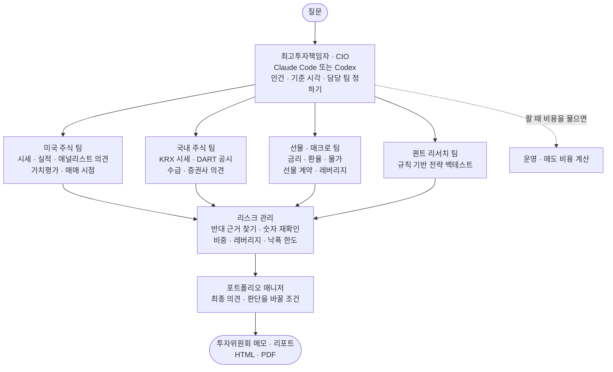
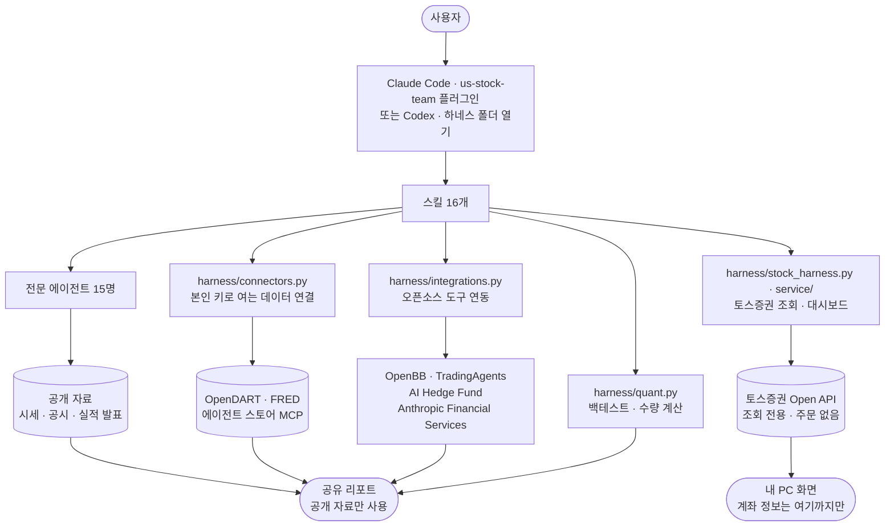

# 주식 리서치 하네스 · AI 헤지펀드 팀

AI에게 주식을 물어보면, 헤지펀드처럼 여러 팀이 나눠 조사하고 서로 검증한 뒤 **주식을 몰라도 읽을 수 있는 한국어 리포트**로 정리해 주는 도구입니다. Claude Code와 Codex에서 씁니다.

- "삼성전자 지금 사도 될까?", "엔비디아 분석해 줘"처럼 평소 말투로 물어보면 됩니다.
- 미국 주식, 국내 주식, 선물·매크로, 퀀트 리서치 네 팀과 리스크 관리, 포트폴리오 매니저까지 AI 15명이 일합니다.
- 결과는 쉬운 말로 쓴 리포트(HTML·PDF)로 받고, 모든 숫자에 출처가 붙습니다.
- DART, 한국은행, FRED 같은 데이터와 토스증권 계좌는 원하는 사람만 본인 키로 연결합니다.

소개 페이지와 실제 리포트 예시: https://axlabs-stock-harness.onpod.ai

> 이 도구는 조사, 백테스트, 모의 포트폴리오까지만 합니다. 실제 주문은 하지 않으며 투자 권유가 아닙니다. 투자 판단과 책임은 본인에게 있습니다. 선물은 원금보다 큰 손실이 날 수 있습니다.

---

## 처음이라면 이 순서대로

### 1. 준비물 확인

아래 둘 중 **하나만** 있으면 됩니다.

| 프로그램 | 설치 안내 |
| --- | --- |
| Claude Code | https://code.claude.com/docs |
| Codex | https://developers.openai.com/codex |

공개 자료 조사만 할 때는 따로 API 키가 필요 없습니다. 쓰고 있는 Claude 또는 Codex 계정을 그대로 사용합니다.

### 2. 내려받기

**방법 A · ZIP으로 받기 (가장 쉬움)**

1. [Releases 페이지](https://github.com/seulee26/stock-team-harness/releases/latest)에서 ZIP 파일을 받습니다.
2. 압축을 풉니다. 풀린 폴더를 앞으로 "하네스 폴더"라고 부르겠습니다.

**방법 B · git으로 받기**

```sh
git clone https://github.com/seulee26/stock-team-harness.git
```

### 3. 실행하기

터미널을 열고 하네스 폴더로 이동한 뒤, 쓰는 프로그램에 맞는 명령을 실행합니다.

**Claude Code**

```sh
claude --plugin-dir ./claude/us-stock-team
```

**Codex**

```sh
codex
```

Codex 앱을 쓴다면 하네스 폴더를 프로젝트 폴더로 열면 됩니다.

### 4. 첫 질문 해 보기

무엇부터 해야 할지 모르겠다면 이렇게 물어보세요. 시작 가이드가 지금 상태를 확인하고 한 단계씩 안내합니다.

```text
처음인데 뭐부터 하면 돼?
```

바로 분석을 받고 싶다면 종목 이름만 바꿔서 물어보세요.

```text
엔비디아(NVDA) 지금 사도 될까? 초보자도 이해할 수 있게 분석해 줘.
```

```text
삼성전자(005930) 최근 실적과 수급을 쉽게 정리해 줘.
```

몇 분 뒤 리포트 파일이 만들어집니다. 리포트에는 한 줄 결론과 이유, 지금 가격이 비싼지 싼지, 사도 되는 조건과 기다려야 하는 조건, 조심할 점, 근거 자료의 출처가 담깁니다.

---

## 한눈에 보는 구조

### 회사처럼 나눈 조직

질문이 들어오면 현재 대화가 최고투자책임자(CIO) 역할을 맡아 필요한 팀에만 일을 나눠 줍니다.



| 조직 | 에이전트 | 맡은 일 |
| --- | --- | --- |
| 미국 주식 팀 | `market`, `fundamentals`, `analyst-opinions`, `valuation`, `trade-timing` | 미국 상장 주식·ETF의 시세, 실적, 증권사 의견, 적정 가격, 매매 조건 |
| 국내 주식 팀 | `kr-market`, `kr-fundamentals`, `kr-flows` | 코스피·코스닥 시세, DART 공시와 지배구조, 외국인·기관 수급과 증권사 의견 |
| 선물·매크로 팀 | `macro`, `futures` | 금리·환율·물가와 중앙은행 일정, 선물 계약 명세·증거금·레버리지 |
| 퀀트 리서치 팀 | `quant-research` | 이동평균·모멘텀·돌파 전략 백테스트와 과최적화 점검 |
| 리스크 관리 | `risk-review`, `risk-officer` | 결론이 틀릴 수 있는 이유 찾기, 포트폴리오 한도와 규정 점검 |
| 운용 | `portfolio-manager` | 팀 의견을 종합한 최종 의견 |
| 운영 | `stock-sale-fee` | 팔 때 드는 수수료와 세금 |

### 하네스 구성

스킬과 에이전트는 AI가 읽는 지침이고, `harness/`와 `service/`는 내 PC에서 실행되는 프로그램입니다.



- 화살표는 일을 시키거나 자료가 흘러가는 방향입니다.
- 공유 리포트에는 공개 자료만 들어갑니다. 토스증권 계좌 정보는 내 PC 화면에서만 보입니다.
- 데이터 연결, 토스증권, 오픈소스 도구는 모두 선택 사항입니다. 연결하지 않아도 리서치 팀은 동작합니다.

---

## Claude Code 플러그인으로 쓰기

이 저장소의 `claude/us-stock-team` 폴더가 Claude Code 플러그인입니다. 불러오면 스킬 16개와 전문 에이전트 15명이 추가됩니다.

### 불러오는 방법 두 가지

**방법 1 · 폴더에서 바로 불러오기 (권장)**

하네스 폴더에서 아래 명령으로 시작합니다. 백테스트, 데이터 연결, 토스증권까지 모두 쓸 수 있습니다.

```sh
claude --plugin-dir ./claude/us-stock-team
```

**방법 2 · GitHub에서 설치하기**

Claude Code 안에서 아래 두 줄을 차례로 입력합니다. 한 번 설치하면 어느 폴더에서든 리서치 팀을 부를 수 있습니다.

```text
/plugin marketplace add seulee26/stock-team-harness
```

```text
/plugin install us-stock-team@stock-team-harness
```

방법 2로는 스킬과 에이전트만 설치됩니다. 백테스트, 데이터 연결, 토스증권 조회, 대시보드는 하네스 폴더 안의 프로그램을 쓰기 때문에 방법 1로 실행해야 합니다.

### 스킬 부르는 법

평소 말투로 요청해도 알맞은 스킬이 골라집니다. 직접 고르려면 `/us-stock-team:스킬이름` 뒤에 요청을 적습니다. Codex에서는 `$스킬이름`으로 부릅니다.

```text
/us-stock-team:hedge-fund-desk 엔비디아와 SK하이닉스 중 어디에 비중을 둘지 투자위원회를 열어 줘.
```

| 스킬 | 이럴 때 씁니다 | 요청 예시 |
| --- | --- | --- |
| `stock-harness-start` | 처음 설치했거나 사용법이 궁금할 때 | "처음인데 뭐부터 하면 돼?" |
| `hedge-fund-desk` | 여러 팀이 함께 심사한 결론이 필요할 때 | "투자위원회 열어서 검토해 줘." |
| `us-stock-research` | 미국 종목 하나를 처음부터 끝까지 분석할 때 | "애플 지금 사도 될까?" |
| `kr-stock-research` | 국내 종목을 분석할 때 | "삼성전자 최근 실적과 수급 알려 줘." |
| `futures-macro-research` | 선물이나 금리·환율이 궁금할 때 | "코스피200 선물 한 계약이 얼마짜리야?" |
| `quant-backtest` | 전략이 과거에 통했는지 확인할 때 | "골든크로스 전략 백테스트해 줘." |
| `stock-data-connections` | 내 데이터 키를 연결할 때 | "DART 연결하는 법 알려 줘." |
| `stock-earnings-review` | 실적 발표가 좋았는지 궁금할 때 | "테슬라 이번 분기 실적 어땠어?" |
| `stock-bull-bear-review` | 오를 이유와 내릴 이유를 나란히 볼 때 | "팔란티어 낙관론과 비관론 비교해 줘." |
| `stock-valuation-scenarios` | 적정 가격이 궁금할 때 | "엔비디아 적정 주가를 세 가지 경우로 계산해 줘." |
| `stock-source-evidence` | 숫자의 출처와 날짜를 확인할 때 | "이 매출 숫자 어디서 나온 거야?" |
| `stock-paper-portfolio` | 가짜 돈으로 연습 투자를 할 때 | "1만 달러로 모의 포트폴리오 짜 줘." |
| `stock-toss-readonly` | 내 토스증권 계좌를 조회할 때 | "내 보유 종목 수익률 보여 줘." |
| `stock-harness-integrations` | 오픈소스 도구 설치 상태를 확인할 때 | "연동 도구 설치됐는지 확인해 줘." |
| `stock-harness-vibe-coding` | 하네스에 기능을 직접 추가할 때 | "시세에 데이터 지연 표시를 추가해 줘." |
| `editorial-design` | 리포트를 읽기 편하게 다듬을 때 | "이 리포트 모바일에서 읽기 좋게 고쳐 줘." |

---

## 국내 주식

6자리 종목코드나 국내 회사 이름으로 물어보면 국내 주식 팀이 맡습니다. 금액은 원, 시각은 한국 시간 기준입니다.

- DART 사업·분기보고서에서 실적과 재무를 확인합니다.
- 최대주주 지분, 자사주 소각, 유상증자·전환사채 같은 국내 시장 특유의 항목을 따로 봅니다.
- 외국인·기관 수급, 공매도 잔고, 증권사 목표주가 변화를 날짜와 함께 정리합니다.

데이터를 연결하지 않아도 공개 웹 자료로 조사합니다. 아래 "데이터 연결"을 해 두면 공시와 재무 숫자를 더 빠르고 일관되게 받습니다.

## 선물과 매크로

선물은 적은 증거금으로 큰 금액을 움직이는 상품이라 원금보다 큰 손실이 날 수 있습니다. 하네스는 구조 설명과 계산까지만 합니다.

- 계약 승수, 만기, 증거금을 거래소 공식 명세에서 확인합니다.
- 가격이 1% 움직일 때 손익이 얼마인지, 레버리지가 몇 배인지 금액으로 보여 줍니다.
- 손절 기준으로 몇 계약이 감당 가능한지 계산합니다.

```sh
python3 harness/quant.py size --capital 50000 --risk-pct 1 --entry 5000 --stop 4980 --multiplier 50
```

## 퀀트 백테스트

전략이 과거에 통했는지 일봉 데이터로 확인합니다. 파이썬 기본 기능만 쓰고 주문을 보내지 않습니다.

```sh
# 합성 데이터로 계산 방식 시연
python3 harness/quant.py demo

# 내 일봉 CSV(date, close 열)로 이동평균 교차 전략 검증
python3 harness/quant.py backtest bars.csv --strategy sma-cross --fast 20 --slow 60

# 선물 방식: 자본 5만 달러, 1포인트당 50달러, 계약당 수수료 2.5달러
python3 harness/quant.py backtest bars.csv --strategy breakout --allow-short --capital 50000 --multiplier 50 --fee 2.5
```

전략은 `sma-cross`(이동평균 교차), `momentum`(추세), `breakout`(고점·저점 돌파), `buy-hold`(단순 보유) 네 가지입니다. 결과에는 총수익률, 연환산 수익률, 최대 낙폭, 변동성, 샤프 지수가 단순 보유와 나란히 나옵니다. 백테스트는 과거 기록이며 미래 수익을 보장하지 않습니다. 연속 선물의 만기 교체 손익은 반영하지 않습니다.

---

## 데이터 연결 (선택)

원하는 사람만 본인 키로 연결합니다. 키는 내 터미널에만 넣고 대화창에는 붙여 넣지 않습니다.

```sh
python3 harness/connectors.py doctor
```

| 연결 | 무엇을 주나 | 준비물 |
| --- | --- | --- |
| [에이전트 스토어](https://agent.store/) MCP | 금융감독원 공시와 재무비율, 기업·ETF 데이터, 한국은행·통계청 지표 | agent.store 계정 (유료 호출이 있을 수 있음) |
| [OpenDART](https://opendart.fss.or.kr/) | 국내 상장사 공시 목록, 주요 재무 계정 | 무료 키 |
| [FRED](https://fred.stlouisfed.org/docs/api/api_key.html) | 미국 금리·물가·고용 시계열 | 무료 키 |
| 토스증권 | 국내·미국 공개 시세, 본인 계좌 조회 | Open API 키 |

### 에이전트 스토어 연결

AI3가 운영하는 MCP 게이트웨이입니다. 콘솔에서 `dart`, `corporate-data`, `corp-financials`, `bok-stats` 같은 서버를 켠 뒤 주소 하나만 등록하면 됩니다. 아래 명령이 쓰는 프로그램에 맞는 등록 방법을 보여 줍니다.

```sh
python3 harness/connectors.py agent-store --client claude
```

```sh
python3 harness/connectors.py agent-store --client codex
```

연결되면 국내 주식 팀과 선물·매크로 팀이 이 도구를 먼저 씁니다.

### OpenDART와 FRED

발급받은 키를 내 터미널의 환경 변수로 지정합니다.

```sh
export DART_API_KEY=<YOUR_KEY>
export FRED_API_KEY=<YOUR_KEY>
```

```sh
python3 harness/connectors.py dart-filings 005930 --limit 5
python3 harness/connectors.py dart-financials 005930 --year 2025
python3 harness/connectors.py fred DGS10 --start 2026-01-01
```

받은 데이터는 내 PC에서 리서치에 쓰고 다시 배포하지 않습니다. FRED 자료를 쓴 결과물은 FRED API를 사용했으며 세인트루이스 연준이 보증한 것이 아니라고 밝혀야 합니다.

---

## 토스증권 연결하기 (선택)

연결하면 "내가 가진 종목 기준으로" 답을 받을 수 있습니다.

**준비물**: 토스증권 Open API 키([발급 안내](https://developers.tossinvest.com/docs/auth)), Python 3.9 이상, Node.js 20 이상, Mac·Linux·WSL

```sh
python3 service/launch.py --personal
```

키를 묻는 화면이 나오면 붙여 넣습니다. 입력한 글자는 화면에 보이지 않습니다. 잠시 뒤 브라우저에 내 보유 종목과 매수 가능 금액이 나옵니다.

- 조회만 합니다. 주문 기능이 없습니다.
- 키는 파일이나 브라우저에 저장하지 않습니다.
- 화면은 내 PC 안(localhost)에서만 열립니다.
- 공유용 리포트에는 계좌 정보가 들어가지 않습니다.

토스증권 Open API에 등록한 IP에서 접속해야 합니다. 계좌가 여러 개면 `--personal --account 계좌식별값`으로 고릅니다. 터미널에서 직접 조회하는 방법은 [harness/README.md](harness/README.md)에 있습니다. 토스증권 Open API는 개인용 [이용약관](https://home.tossinvest.com/ko/terms/v2?id=752)을 따릅니다.

---

## 참고한 오픈소스

GitHub에서 별을 많이 받은 퀀트·트레이딩 프로젝트를 읽고 구조를 참고했습니다. 별 수는 2026년 11월 21일 GitHub 기준입니다. 전체 목록과 라이선스 주의사항은 `python3 harness/connectors.py catalog`로 볼 수 있습니다.

### 하네스에 연결된 것

| 도구 | 별 | 하네스에서 쓰는 일 | 라이선스 |
| --- | --- | --- | --- |
| [TradingAgents](https://github.com/TauricResearch/TradingAgents) | 12.3만 | 상승·하락 토론, 위험 토론, 포트폴리오 매니저 구조 | Apache-2.0 |
| [OpenBB](https://github.com/openbq-org/OpenBB) | 7.6만 | Nasdaq 일봉과 미국 SEC 공시 수집 | Apache-2.0 |
| [AI Hedge Fund](https://github.com/virattt/ai-hedge-fund) | 6.5만 | 전략 팀(pod) 구조, 위험 한도, 모의 체결 | MIT |
| [Anthropic Financial Services](https://github.com/anthropics/financial-services) | 4.1만 | 실적·DCF·비교기업·투자 논지 추적 절차 | Apache-2.0 |

네 도구는 선택 설치입니다. Python 3.11 이상이 필요하고 3.12를 권장합니다.

```sh
python3.12 harness/install_integrations.py
python3.12 harness/integrations.py doctor
python3.12 harness/integrations.py plan NVDA
python3.12 harness/integrations.py price AAPL --start 2026-11-12 --end 2026-11-19
python3.12 harness/integrations.py filings NVDA --limit 3
python3.12 harness/integrations.py financial-skills earnings
python3.12 harness/integrations.py paper-demo
```

설치는 API 키 없이 진행됩니다. 원본을 지정된 커밋에서 내려받아 체크섬을 확인하고 `.local/upstream/`에 보관합니다. `price`의 날짜는 조회할 최근 미국 정규장 날짜로 바꿔 쓰세요. 원본 TradingAgents 분석은 `debate` 명령과 전용 모델 키를 쓸 때만 실행됩니다.

### 구조를 참고했거나 따로 설치해 쓸 수 있는 것

| 도구 | 별 | 참고한 점 | 주의 |
| --- | --- | --- | --- |
| [qlib](https://github.com/microsoft/qlib) | 5.0만 | 팩터 연구와 머신러닝 백테스트 흐름 | 기본 데이터는 중국 시장 |
| [vnpy](https://github.com/vnpy/vnpy) | 4.6만 | 선물 중심 이벤트 기반 백테스트 | 실거래 기능 있음 |
| [nautilus_trader](https://github.com/nautechsystems/nautilus_trader) | 3.2만 | 결정적 이벤트 기반 엔진 | LGPL-3.0, 실거래 기능 있음 |
| [Lean](https://github.com/QuantConnect/Lean) | 2.3만 | 연속 선물과 만기 교체 처리 | Docker 필요, 실거래 기능 있음 |
| [backtrader](https://github.com/mementum/backtrader) | 2.4만 | 선물 만기 연결, 증거금과 승수 | GPL-3.0 |
| [yfinance](https://github.com/ranaroussi/yfinance) | 2.6만 | 연속 선물 기호와 공개 시세 | 개인 연구용, 재배포 금지 |
| [quantstats](https://github.com/ranaroussi/quantstats) | 0.8만 | 성과·위험 지표 구성 | Apache-2.0 |
| [PyPortfolioOpt](https://github.com/PyPortfolio/PyPortfolioOpt) | 0.6만 | 포트폴리오 비중 계산 | MIT |
| [FinanceDataReader](https://github.com/FinanceData/FinanceDataReader) | 0.2만 | 국내 종목 목록과 일봉 | MIT |
| [pykrx](https://github.com/sharebook-kr/pykrx) | 0.1만 | KRX 시세·수급·선물 일봉 | LICENSE 파일 없음, KRX 계정 필요할 수 있음 |

하네스는 이 도구들의 코드를 포함하지 않습니다. GPL·AGPL 등 조건이 다른 도구는 번들하지 않았고, 주문 기능이 있는 도구는 백테스트 용도로만 안내합니다. 한국투자증권 Open API처럼 주문 기능이 있는 증권사 연결은 넣지 않았습니다.

---

## 로컬 대시보드 (선택)

Python 3.9 이상과 Node.js 20 이상이 필요합니다. Mac에서는 `start.command`를 더블클릭해도 됩니다.

```sh
python3 service/launch.py
```

예시 포트폴리오, 매도 비용 계산, 가격 조건 알림 예시를 브라우저에서 볼 수 있습니다. `--bizrouter` 옵션을 붙이면 공개 리서치 질문의 설명 순서에 [BizRouter](https://bizrouter.ai/docs/chat-completions) 모델 라우팅을 적용합니다. 공개 종목·주제만 전달하고 원문 질문과 계좌 데이터는 보내지 않습니다. 사용량에 따라 본인의 모델 제공자 요금이 발생할 수 있습니다.

## 자주 막히는 곳

| 증상 | 해결 |
| --- | --- |
| `claude: command not found` | Claude Code가 설치되지 않았습니다. 준비물 단계의 설치 안내를 먼저 따라 하세요. |
| 스킬이 목록에 안 보여요 | 하네스 폴더 안에서 실행했는지 확인하세요. `ls`를 입력했을 때 `claude`, `harness` 폴더가 보여야 합니다. |
| `python3: command not found` | Python이 없습니다. https://www.python.org/downloads 에서 설치하세요. 리서치만 할 때는 없어도 됩니다. |
| DART·FRED 조회가 실패해요 | `python3 harness/connectors.py doctor`로 키가 지정됐는지 확인하세요. |
| 에이전트 스토어 도구가 안 보여요 | 콘솔에서 서버를 켰는지, Claude Code에서 `/mcp`로 로그인했는지 확인하세요. |
| 토스 조회가 실패해요 | 토스증권 Open API에 지금 쓰는 IP가 등록돼 있는지, 키를 정확히 붙여 넣었는지 확인하세요. |
| Windows에서 토스 조회가 안 돼요 | 토스 계좌 조회는 Mac, Linux, WSL에서 지원합니다. |

## 폴더 구성

| 경로 | 내용 |
| --- | --- |
| `claude/us-stock-team/` | Claude Code 플러그인 (스킬, 에이전트) |
| `.agents/skills/`, `.codex/agents/` | Codex용 스킬과 에이전트 |
| `harness/quant.py` | 백테스트와 수량 계산 |
| `harness/connectors.py` | 데이터 연결 (OpenDART, FRED, 에이전트 스토어 안내) |
| `harness/integrations.py` | 오픈소스 도구 네 가지 연동 |
| `harness/stock_harness.py` | 토스증권 조회, 매도 비용, 조건 알림 |
| `service/` | 로컬 대시보드 |

## 검증

```sh
python3 -m unittest discover -s harness -p 'test_*.py'
node --test service/server.test.mjs service/research-chat.test.mjs
```

## 만든 곳

[AX LABS](https://theaxlabs.com/)가 만들어 공개했습니다. AX LABS는 기업의 AI 전환을 돕는 컨설팅, AI 에이전트 구축, 임원·실무자 교육을 합니다.

## 라이선스

하네스 소스는 [MIT 라이선스](LICENSE)입니다. 연동하는 제3자 도구의 라이선스와 외부 데이터 제공자의 이용 조건은 각 도구에서 확인하세요.
