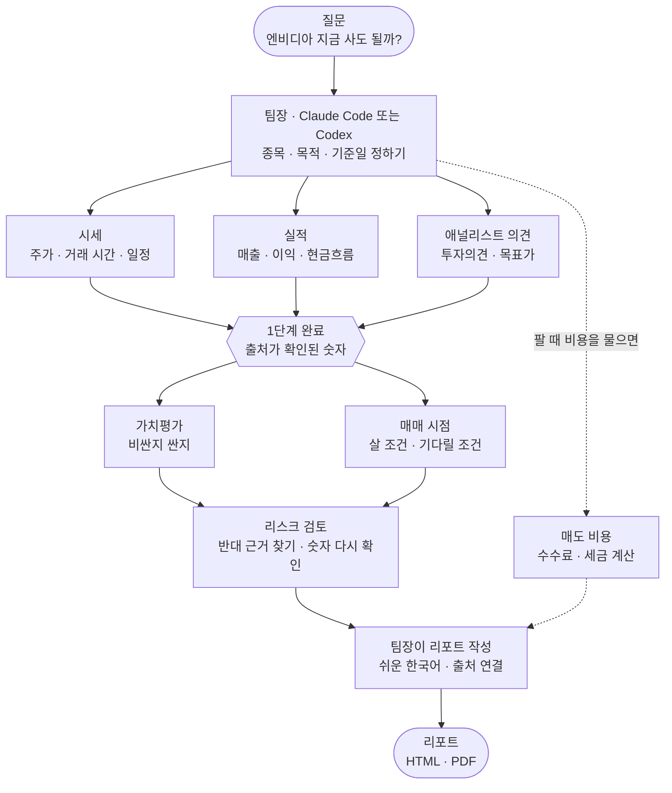
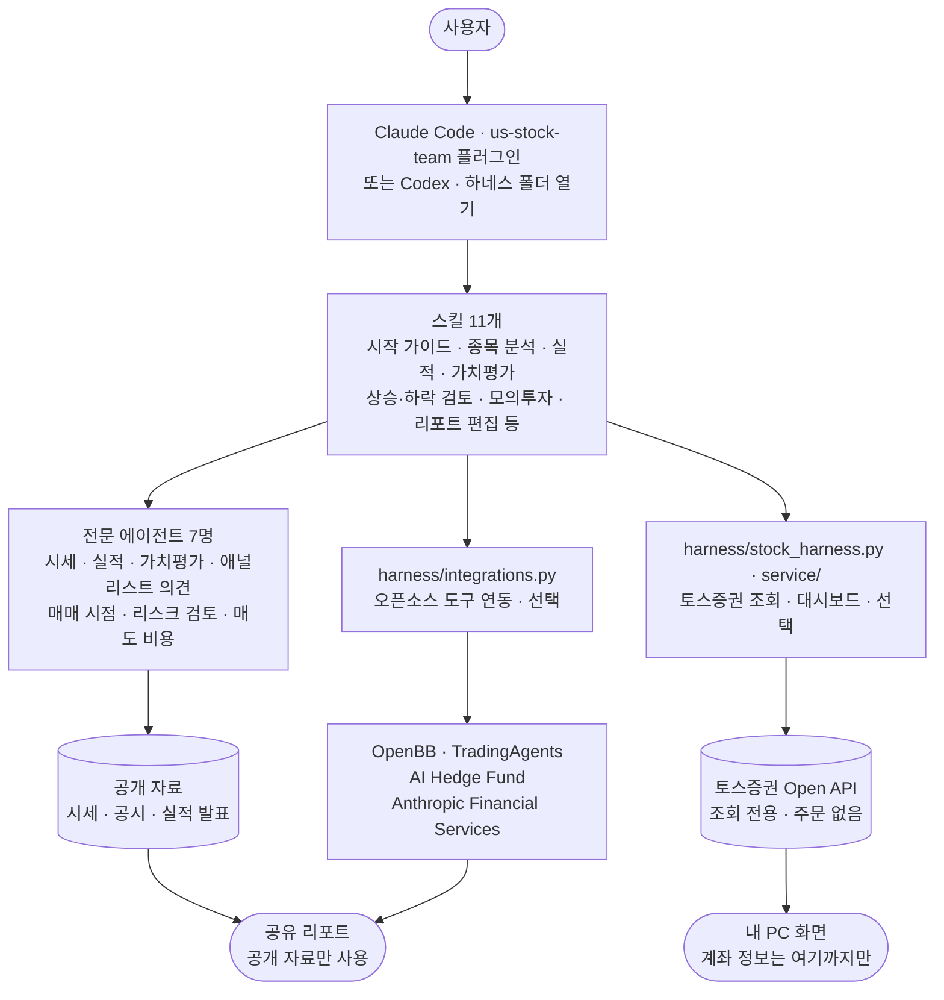

# 주식 리서치 하네스

미국 주식이 궁금할 때 AI에게 물어보면, AI 여러 명이 팀으로 나눠 조사하고 **주식을 몰라도 읽을 수 있는 한국어 리포트**로 정리해 주는 도구입니다.

- "엔비디아 지금 사도 될까?"처럼 평소 말투로 물어보면 됩니다.
- 시세, 실적, 적정 가격, 애널리스트 의견, 위험 요소를 AI 7명이 각자 맡아 조사합니다.
- 결과는 쉬운 말로 쓴 리포트(HTML·PDF)로 받고, 모든 숫자에 출처가 붙습니다.
- 토스증권을 연결하면 내 보유 종목과 매수 가능 금액 기준으로 답합니다. (선택)

소개 페이지와 실제 리포트 예시: https://axlabs-stock-harness.onpod.ai

> 이 도구는 조사와 정리를 돕습니다. 투자 권유가 아니며, 주문은 하지 않습니다. 투자 판단과 책임은 본인에게 있습니다.

---

## 처음이라면 이 순서대로

### 1. 준비물 확인

아래 둘 중 **하나만** 있으면 됩니다. 둘 다 없다면 하나를 먼저 설치하세요.

| 프로그램 | 설치 안내 |
| --- | --- |
| Claude Code | https://code.claude.com/docs |
| Codex | https://developers.openai.com/codex |

공개 자료 조사만 할 때는 따로 API 키가 필요 없습니다. 쓰고 있는 Claude 또는 Codex 계정을 그대로 사용합니다.

### 2. 내려받기

**방법 A · ZIP으로 받기 (가장 쉬움)**

1. [Releases 페이지](https://github.com/seulee26/stock-team-harness/releases/latest)에서 ZIP 파일을 받습니다.
2. 압축을 풉니다. 풀린 폴더를 앞으로 "하네스 폴더"라고 부르겠습니다.

**방법 B · git으로 받기**

```sh
git clone https://github.com/seulee26/stock-team-harness.git
```

### 3. 실행하기

터미널을 열고 하네스 폴더로 이동한 뒤, 쓰는 프로그램에 맞는 명령을 실행합니다.

**Claude Code**

```sh
claude --plugin-dir ./claude/us-stock-team
```

**Codex**

```sh
codex
```

Codex 앱을 쓴다면 하네스 폴더를 프로젝트 폴더로 열면 됩니다.

### 4. 첫 질문 해 보기

실행된 화면에 아래처럼 입력합니다. 종목 이름만 바꿔서 쓰세요.

```text
엔비디아(NVDA) 지금 사도 될까? 초보자도 이해할 수 있게 분석해 줘.
```

무엇부터 해야 할지 모르겠다면 이렇게 물어보세요. 시작 가이드가 지금 상태를 확인하고 한 단계씩 안내합니다.

```text
처음인데 뭐부터 하면 돼?
```

몇 분 뒤 리포트 파일이 만들어집니다. 리포트에는 이런 내용이 담깁니다.

- 한 줄 결론과 그 이유
- 지금 가격이 비싼지 싼지
- 사도 되는 조건, 기다려야 하는 조건
- 조심할 점
- 근거로 쓴 자료의 출처

---

## 한눈에 보는 구조

### 에이전트 팀이 일하는 순서

질문을 받으면 팀장(Claude Code 또는 Codex)이 전문가 7명에게 일을 나눠 줍니다. 같은 줄에 있는 역할은 동시에 조사합니다.



### 하네스 구성

스킬과 에이전트는 AI가 읽는 지침이고, `harness/`와 `service/`는 내 PC에서 실행되는 프로그램입니다.



읽는 법

- 화살표는 일을 시키거나 자료가 흘러가는 방향입니다.
- **공유 리포트**에는 공개 시세와 공시만 들어갑니다. 토스증권 계좌 정보는 내 PC 화면에서만 보이고 리포트나 리서치 에이전트로 넘어가지 않습니다.
- 토스증권과 오픈소스 도구는 선택 사항입니다. 연결하지 않아도 리서치 팀은 그대로 동작합니다.

---

## Claude Code 플러그인으로 쓰기

이 저장소의 `claude/us-stock-team` 폴더가 Claude Code 플러그인입니다. 플러그인을 불러오면 스킬 11개와 전문 에이전트 7명이 Claude Code에 추가됩니다.

### 불러오는 방법 두 가지

**방법 1 · 폴더에서 바로 불러오기 (권장)**

하네스 폴더에서 아래 명령으로 Claude Code를 시작합니다. 토스증권 연결과 대시보드까지 모두 쓸 수 있습니다.

```sh
claude --plugin-dir ./claude/us-stock-team
```

**방법 2 · GitHub에서 설치하기**

Claude Code 안에서 아래 두 줄을 차례로 입력합니다. 한 번 설치하면 어느 폴더에서든 리서치 팀을 부를 수 있습니다.

```text
/plugin marketplace add seulee26/stock-team-harness
```

```text
/plugin install us-stock-team@stock-team-harness
```

방법 2로는 리서치 스킬과 에이전트만 설치됩니다. 토스증권 조회, 대시보드, 오픈소스 도구 연동은 하네스 폴더 안의 프로그램을 쓰기 때문에 방법 1로 실행해야 합니다.

### 스킬 부르는 법

평소 말투로 요청해도 Claude가 알맞은 스킬을 고릅니다. 직접 고르고 싶으면 `/us-stock-team:스킬이름` 뒤에 요청을 적습니다.

```text
/us-stock-team:us-stock-research MSFT 최신 실적과 주가를 초보자용으로 분석해 줘.
```

| 스킬 | 이럴 때 씁니다 | 요청 예시 |
| --- | --- | --- |
| `stock-harness-start` | 처음 설치했거나 사용법이 궁금할 때 | "처음인데 뭐부터 하면 돼?" |
| `us-stock-research` | 종목 하나를 처음부터 끝까지 분석할 때 | "애플 지금 사도 될까?" |
| `stock-earnings-review` | 실적 발표가 좋았는지 궁금할 때 | "테슬라 이번 분기 실적 어땠어?" |
| `stock-bull-bear-review` | 오를 이유와 내릴 이유를 나란히 보고 싶을 때 | "팔란티어 낙관론과 비관론 비교해 줘." |
| `stock-valuation-scenarios` | 적정 가격이 얼마인지 궁금할 때 | "엔비디아 적정 주가를 세 가지 경우로 계산해 줘." |
| `stock-source-evidence` | 숫자의 출처와 날짜를 확인할 때 | "이 매출 숫자 어디서 나온 거야?" |
| `stock-paper-portfolio` | 가짜 돈으로 연습 투자를 해 볼 때 | "1만 달러로 모의 포트폴리오 짜 줘." |
| `stock-toss-readonly` | 내 토스증권 계좌를 조회할 때 | "내 보유 종목 수익률 보여 줘." |
| `stock-harness-integrations` | 오픈소스 도구 설치 상태를 확인할 때 | "연동 도구 설치됐는지 확인해 줘." |
| `stock-harness-vibe-coding` | 하네스에 기능을 직접 추가할 때 | "시세에 데이터 지연 표시를 추가해 줘." |
| `editorial-design` | 리포트를 더 읽기 편하게 다듬을 때 | "이 리포트 모바일에서 읽기 좋게 고쳐 줘." |

### 팀 구성

질문을 받으면 Claude가 팀장을 맡아 아래 전문가에게 일을 나눠 주고, 결과를 모아 리포트를 씁니다.

| 에이전트 | 맡은 일 |
| --- | --- |
| 시세 (`market`) | 주가, 거래 시간, 실적 발표 일정 |
| 실적 (`fundamentals`) | 회사가 얼마나 벌고 쓰는지 |
| 가치평가 (`valuation`) | 지금 가격이 비싼지 싼지 |
| 애널리스트 의견 (`analyst-opinions`) | 증권사 투자의견과 목표가 |
| 매매 시점 (`trade-timing`) | 살 조건, 기다릴 조건, 팔 조건 |
| 리스크 검토 (`risk-review`) | 결론이 틀릴 수 있는 이유를 찾고 숫자를 다시 확인 |
| 매도 비용 (`stock-sale-fee`) | 팔 때 드는 수수료와 세금 |

### Codex에서는

Codex는 플러그인 설치 없이 하네스 폴더를 열기만 하면 같은 스킬과 팀을 씁니다. 스킬은 `$스킬이름`으로 부릅니다.

```text
$us-stock-research NVDA의 최근 실적과 가격 조건을 팀 검토해 줘.
```

---

## 토스증권 연결하기 (선택)

연결하면 "내가 가진 종목 기준으로" 답을 받을 수 있습니다. 연결하지 않아도 공개 자료 리서치는 모두 됩니다.

**준비물**

- 토스증권 Open API 키 ([발급 안내](https://developers.tossinvest.com/docs/auth))
- Python 3.9 이상, Node.js 20 이상
- Mac, Linux 또는 Windows의 WSL

**실행**

하네스 폴더에서 아래 명령을 실행합니다.

```sh
python3 service/launch.py --personal
```

키를 묻는 화면이 나오면 붙여 넣습니다. 입력한 글자는 화면에 보이지 않습니다. 잠시 뒤 브라우저에 내 보유 종목과 매수 가능 금액이 나옵니다.

**안심하고 써도 되는 이유**

- 조회만 합니다. 주문 기능이 없습니다.
- 키는 파일이나 브라우저에 저장하지 않습니다.
- 화면은 내 PC 안(localhost)에서만 열립니다.
- 공유용 리포트에는 계좌 정보가 들어가지 않습니다.

토스증권 Open API에 등록한 IP에서 접속해야 합니다. 계좌가 여러 개면 `--personal --account 계좌식별값`으로 고릅니다. 터미널에서 직접 조회하는 방법은 [harness/README.md](harness/README.md)에 있습니다. 토스증권 Open API는 개인용 [이용약관](https://home.tossinvest.com/ko/terms/v2?id=752)을 따릅니다.

---

## 더 해 보기 (선택)

### 로컬 대시보드

Python 3.9 이상과 Node.js 20 이상이 필요합니다. Mac에서는 `start.command`를 더블클릭해도 됩니다.

```sh
python3 service/launch.py
```

예시 포트폴리오, 매도 비용 계산, 가격 조건 알림 예시를 브라우저에서 볼 수 있습니다.

`--bizrouter` 옵션을 붙이면 공개 리서치 질문의 설명 순서에 [BizRouter](https://bizrouter.ai/docs/chat-completions) 모델 라우팅을 적용합니다. 공개 종목·주제만 전달하고 원문 질문과 계좌 데이터는 보내지 않습니다. 사용량에 따라 본인의 모델 제공자 요금이 발생할 수 있습니다.

### 오픈소스 도구 네 가지 연동

더 깊은 데이터와 분석이 필요할 때 설치합니다. Python 3.11 이상이 필요하고 3.12를 권장합니다.

| 도구 | 하네스에서 쓰는 일 | 라이선스 |
| --- | --- | --- |
| [OpenBB](https://github.com/openbq-org/OpenBB) | Nasdaq 공개 시세와 미국 SEC 공시를 수집하고 출처와 날짜를 기록합니다. | Apache-2.0 |
| [TradingAgents](https://github.com/TauricResearch/TradingAgents) | 공개 종목의 상승·하락 논지를 비교합니다. 원본 모델 실행은 선택 사항입니다. | Apache-2.0 |
| [AI Hedge Fund](https://github.com/virattt/ai-hedge-fund) | 가상 자금으로 포트폴리오와 위험관리 흐름을 확인합니다. | MIT |
| [Anthropic Financial Services](https://github.com/anthropics/financial-services) | 시장 조사·실적 리뷰·가치평가에 맞는 원본 금융 스킬을 찾습니다. | Apache-2.0 |

```sh
python3.12 harness/install_integrations.py
python3.12 harness/integrations.py doctor
```

설치는 API 키 없이 진행됩니다. 원본을 지정된 커밋에서 내려받아 체크섬을 확인하고 `.local/upstream/`에 보관합니다. 일부만 설치하려면 `python3.12 harness/install_integrations.py openbb financial-services`처럼 이름을 적습니다.

```sh
python3.12 harness/integrations.py plan NVDA
python3.12 harness/integrations.py price AAPL --start 2026-11-12 --end 2026-11-19
python3.12 harness/integrations.py filings NVDA --limit 3
python3.12 harness/integrations.py financial-skills earnings
python3.12 harness/integrations.py paper-demo
```

`price`의 날짜는 조회할 최근 미국 정규장 날짜로 바꿔 쓰세요. 가상 포트폴리오는 실제 계좌나 주문 없이 실행됩니다. 원본 TradingAgents 분석은 `debate` 명령과 전용 모델 키를 쓸 때만 실행됩니다. 명령별 옵션은 `--help`로 확인합니다.

### 토스증권 CLI

```sh
python3 harness/stock_harness.py portfolio
python3 harness/stock_harness.py sale-fee KOSPI 100000000
python3 harness/stock_harness.py check-alert
```

키는 하네스 폴더 바깥의 소유자 전용 파일(권한 600)에 `TOSSINVEST_CLIENT_ID`, `TOSSINVEST_CLIENT_SECRET`으로 적고, `TOSSINVEST_ENV_FILE` 환경변수로 그 파일을 가리킵니다. 자세한 내용은 [harness/README.md](harness/README.md)를 보세요.

---

## 자주 막히는 곳

| 증상 | 해결 |
| --- | --- |
| `claude: command not found` | Claude Code가 설치되지 않았습니다. 준비물 단계의 설치 안내를 먼저 따라 하세요. |
| 스킬이 목록에 안 보여요 | 하네스 폴더 안에서 실행했는지 확인하세요. `ls`를 입력했을 때 `claude`, `harness` 폴더가 보여야 합니다. |
| `python3: command not found` | Python이 없습니다. https://www.python.org/downloads 에서 설치하세요. 리서치만 할 때는 없어도 됩니다. |
| 토스 조회가 실패해요 | 토스증권 Open API에 지금 쓰는 IP가 등록돼 있는지, 키를 정확히 붙여 넣었는지 확인하세요. |
| Windows에서 토스 조회가 안 돼요 | 토스 계좌 조회는 Mac, Linux, WSL에서 지원합니다. Windows에서는 WSL 안에서 실행하세요. |
| 리포트 숫자가 실제와 달라요 | 리포트 상단의 기준 시각을 확인하세요. 시세는 미국 동부 시간, 달러 기준입니다. |

## 폴더 구성

| 경로 | 내용 |
| --- | --- |
| `claude/us-stock-team/` | Claude Code 플러그인 (스킬, 에이전트) |
| `.agents/skills/`, `.codex/agents/` | Codex용 스킬과 에이전트 |
| `harness/` | 토스증권 조회, 오픈소스 도구 연동 프로그램 |
| `service/` | 로컬 대시보드 |

## 검증

```sh
python3 -m unittest discover -s harness -p 'test_*.py'
node --test service/server.test.mjs service/research-chat.test.mjs
```

## 만든 곳

[AX LABS](https://theaxlabs.com/)가 만들어 공개했습니다. AX LABS는 기업의 AI 전환을 돕는 컨설팅, AI 에이전트 구축, 임원·실무자 교육을 합니다. 문의: help@theaxlabs.com

## 라이선스

하네스 소스는 [MIT 라이선스](LICENSE)입니다. 연동하는 제3자 도구의 라이선스와 외부 데이터 제공자의 이용 조건은 각 도구에서 확인하세요.
