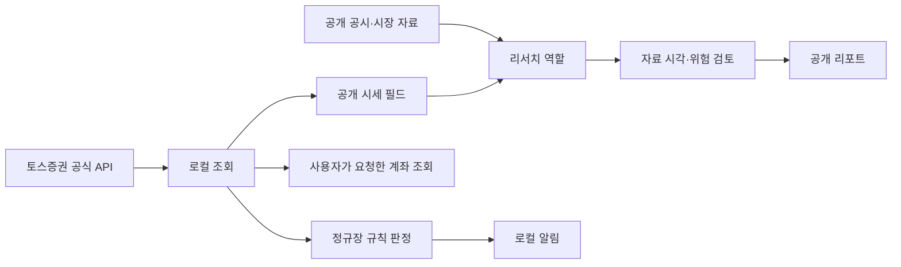

# 주식 리서치 하네스 설계

## 데이터가 흐르는 곳

**공개 리서치**는 조사 시각을 고정하고 시세·공시·증권사 의견을 병렬로 확인합니다. 그 결과를 바탕으로 가치평가와 매수 시점을 계산하고, 별도 위험 검토를 거칩니다. 팀에 전달하는 토스 시세는 `market-packet`의 종목·가격·통화·시각·공식 출처 필드로 한정합니다. 심층 리포트는 `research-check`를 사용해 여섯 역할의 자료가 기준시각 내에 공개됐는지 확인합니다. 출처의 내용과 수치 대조는 조사팀이 수행합니다.

**계좌 자료**는 사용자가 요청한 때 로컬에서 조회합니다. 등록된 REST 조회 주소와 공식 실시간 호스트에 TLS로 직접 연결하고, 연결이 다른 주소로 바뀌는 리디렉션을 차단합니다. 실시간 수신 라이브러리에는 인증서 검증을 마친 소켓만 넘깁니다. 키 파일과 토큰 캐시는 소유자 전용 권한을 확인합니다. 자식 알림 프로세스에는 필요한 기본 환경 변수만 넘깁니다.

**알림**은 정규장 캘린더와 완결된 분봉으로 판정합니다. `replay-alert`는 날짜순으로 이미 끝난 세션을 처리하며, 직전 거래일이 맞지 않거나 불완전하면 연속 기록을 끊습니다. 검토 시점 검증에 사용할 수 있습니다.

## 선택 설치하는 공개 도구

| 실행 도구 | 하네스 연결 |
|---|---|
| OpenBB | `price`가 Nasdaq 일봉, `filings`가 SEC EDGAR 공시 목록을 정규화합니다. |
| TradingAgents | `debate`가 공개 종목에 대한 상승·하락·위험 그래프를 전용 모델 키로 명시적으로 실행합니다. |
| AI Hedge Fund | `paper`가 모의 체결 엔진을 실행하고 체결·현금·보유 수량을 반환합니다. |
| Anthropic Financial Services | `financial-skills`가 시장 조사·실적·가치평가·DCF 및 비교기업 방법론을 작업별로 찾습니다. |

기본 조사는 Codex 또는 Claude Code의 여섯 전문 역할이 맡습니다. `integrations.py plan`에는 도구별 담당 단계가 표시됩니다. 설치 원본은 고정한 소스의 체크섬을 확인한 뒤 각각의 로컬 환경에 보관합니다. [TradingAgents](https://github.com/TauricResearch/TradingAgents/tree/9fa1196fffbcfd9de5146d2dd2869df84ab99838) · [OpenBB](https://github.com/openbq-org/OpenBB/tree/f0f1852b96dd3fc4d5868f8863cbe053ff49c6cd) · [AI Hedge Fund](https://github.com/virattt/ai-hedge-fund/tree/5c553b5222044f6a5527bd377b4104c50ee0ad28) · [Financial Services](https://github.com/anthropics/financial-services/tree/3e32c2287dcb637c184c01cc0ad82d6af7e9bb0f)

어댑터는 임시 작업 폴더, 허용한 환경 변수, 정해진 JSON 입력을 사용합니다. 모델 토론에만 전용 API 키를 넘깁니다. Anthropic 로컬 플러그인 사본은 외부 MCP와 훅 구성을 제외합니다.

## 팀 구조와 추가 경로

리서치는 네 팀으로 나뉩니다. 미국 주식 팀과 국내 주식 팀은 시세·공시·의견을 병렬로 조사하고, 선물·매크로 팀은 거시 지표와 계약 명세를, 퀀트 리서치 팀은 규칙 기반 전략 검증을 맡습니다. 리스크 관리가 논지와 포트폴리오 한도를 점검한 뒤 포트폴리오 매니저가 최종 의견을 냅니다. 견해는 에이전트가 내고, 수량과 한도는 `quant.py`의 계산으로 정합니다. 리스크 점검은 비중을 줄이기만 합니다.

| 경로 | 역할 |
|---|---|
| `quant.py` | 사용자가 준 일봉으로 백테스트와 수량 계산을 합니다. 네트워크와 주문 경로가 없습니다. |
| `connectors.py` | OpenDART와 FRED의 고정된 HTTPS 호스트에만 연결합니다. 리디렉션을 따르지 않고, 키는 환경 변수에서만 읽으며 출력과 오류에 넣지 않습니다. |
| `broadcast.py` | 대본 JSON을 2D 슬라이드 해설 영상으로 만듭니다. 기본은 내 PC의 Chrome, ffmpeg, 선택 설치한 TTS(Supertonic)만 실행하고 모델 API와 외부 업로드 경로가 없습니다. 사용자가 `--tts typecast`나 `--tts elevenlabs`를 고르면 해설 문장만 해당 서비스의 고정된 HTTPS 호스트로 보내고, 키는 환경 변수에서만 읽습니다. |
| 에이전트 스토어 | MCP 게이트웨이 등록 방법만 안내합니다. 등록과 로그인은 사용자가 자신의 AI 프로그램에서 직접 합니다. |

주문 기능이 있는 증권사·거래소 연결은 포함하지 않습니다.

## 배포와 운영

배포 빌드는 지정된 파일에서만 바이트를 읽습니다. 인증 정보와 개인 경로의 흔적을 검사하며, 계좌 응답 JSON과 로컬 설정은 배포 범위에서 제외합니다. 실시간 수신에 필요한 패키지는 고정 버전과 휠 해시를 사용합니다.

소유자 권한은 다른 사용자와의 파일 접근을 막습니다. 같은 macOS 사용자로 실행한 다른 프로그램에는 해당 사용자의 파일 권한이 적용됩니다. 외부 프로젝트를 직접 시험할 때는 별도 OS 사용자나 홈 폴더를 연결하지 않은 격리 환경에서 모의 데이터를 사용합니다.
